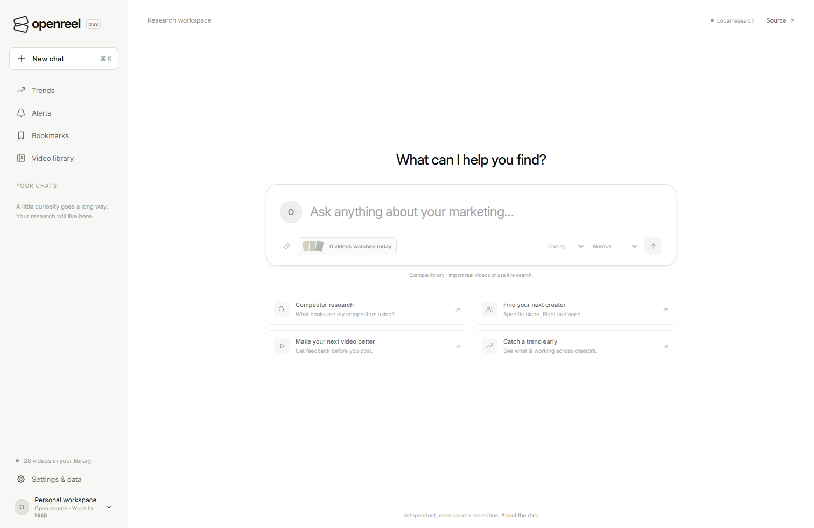

# OpenReel

An independently written, open source recreation working toward full parity with Lightreel’s March 2026 launch demo: video critique, creator discovery, hooks, trends, and cited research.



**Full 1:1 parity remains open.** The normal local product corpus now serves **154,424 real records across 4,621 creator identities** through the API and browser. The separately verified hosted corpus contains **4,424 real records**. Real local speech/vision inference also works, with documented interpretation errors. Broad profile and critique quality, current trend evidence, complete visual-state verification and hosted AI remain open. See [the parity matrix](docs/PARITY.md) and [verification record](docs/VERIFICATION.md).

[Hosted app](https://openreel-ugc-mchdich.red-boar-0376.chatgpt.site/) · [Source](https://github.com/mchdich/openreel-ugc) · [CI](https://github.com/mchdich/openreel-ugc/actions/workflows/ci.yml). The source includes saved-source continuity, bounded real-corpus pattern browsing, source-aware cover badges, public-player metadata collection and configurable local chat deadlines. Exact matching publication/deployment checks are recorded with each source release artifact.

The starter library is fictional. Free creator collection and deterministic library research work without paid credentials. Lightreel’s private index, application source, proprietary models, and demo media are not included.

## Run locally

Use **Node.js 24 or newer**. There are zero runtime package dependencies; optional corpus storage uses Node’s built-in SQLite.

```sh
npm start
```

Open [http://localhost:3000](http://localhost:3000). The server binds to loopback by default. To check and package the source:

```sh
npm test
npm run build
```

The portable Worker entry point is `dist/server/index.js`. Building does not publish it. Node uses filesystem SQLite; the deployed Worker uses a migrated D1 database. They are separate stores; see [CORPUS.md](docs/CORPUS.md).

## Research flows

- **Library:** research imported records or the labeled fictional examples. Creator filters combine topic, school/location, follower bounds, counts, public contacts, and email-in-bio requirements. Unknown metrics cannot satisfy numeric filters.
- **Collect creator:** enter a known public TikTok handle in Library or Settings & data. The official public creator embed supplies its available video selection, public bio, followers, and views without a paid API. This is a bounded profile snapshot, not arbitrary keyword search or the creator’s complete history.
- **Import URL:** fetch a direct public TikTok video’s caption, author and thumbnail through official oEmbed. Short links are rejected. Missing metrics remain unavailable; captions are not transcripts.
- **Video:** attach or drop a supported file up to 50 MiB and ten minutes. The browser prepares up to eight timestamped JPEGs. When transcription is configured, it also extracts mono audio locally and transcribes it when you send. A manual transcript takes precedence. The configured vision model receives samples and unverified transcript text.
- **Video follow-ups:** successful analysis retains the video’s frame context in memory for at most two chats. Choose Video to reuse it. Reload or eviction requires reattachment. Explicit Library, Corpus, or Live search selection does not silently reuse retained frames.
- **Corpus:** when server storage is configured, research a bounded retrieved subset of its real records. Global corpus counts remain separate from records examined in an answer.
- **Live search:** Apify supports bounded keyword discovery: Normal requests up to 15 records; Deep research up to 30. No-key mode refreshes at most three public creators selected from an existing real seed index; it cannot discover creators outside that index. An actual local NYU browser flow refreshed three creators; discovery and chat responses arrived 2.666 and 20.163 seconds after page start. Hosted creator-embed access returned HTTP 502 in the recorded smoke check. Successful hosted refresh and paid end-to-end Apify discovery remain unverified.
- **Sources and trends:** Trends offers explicit Corpus and Library sources. A configured corpus is the default; an explicit Library choice survives reload. Corpus searches retrieve at most 100 real records with separate sample metrics and global totals, cancellation and retry. Available supplied covers represent distinct creators. Open canonical TikTok links or official numeric-ID players. Pattern groups require at least two distinct creator identities and use supplied format labels or explicit phrases in attributed visual descriptions. Groups retain exact evidence excerpts and posting-date coverage; upstream AI descriptions and archival patterns do not establish current emergence.
- **Dated format momentum (1.3.0):** ask Library or Corpus, “What skincare formats are gaining share as of 2024-07-21 over 7 days?” The deterministic answer compares adjacent supplied posting-date windows and reports clip/creator counts, sample shares, and actual representative sources. Without an as-of date it uses today’s UTC calendar date; the default window is seven days, with an explicit 1–90-day range. Corpus retrieves each dated window separately: at most 125 records per window in Normal or 500 per window in Deep (250/1,000 total). Topic/profile filters precede each limit; relevance/ID ordering is not random or representative sampling. These bounded samples and a separate full historical cohort are [documented separately](docs/RESEARCH_DATA.md#historical-format-share-comparison); neither establishes what is emerging today across TikTok.
- **Workspace:** composer cover previews use the selected source and latest applicable answer; unavailable imagery stays neutral. Pattern research uses the displayed pattern’s source. Browser-local chats retain their selected Corpus, Library or Live source across reload and history navigation. Cancelling or clearing an attachment restores the prior source; video frames remain in memory only. Cited clips stay beside findings, while additional matching records remain available in an expandable list. Bookmarks, imports/exports and saved alerts are available. Alerts check the library while the app is open; there is no background email/push service.

Public-bio school/location matches are self-description evidence, not independently verified enrollment or residence. Ambiguous prose, caption mentions, negation and conflicting bio labels do not establish those fields. See [DATA.md](docs/DATA.md).

## Persistent corpus

```sh
node scripts/corpus.js init --db data/corpus.sqlite
node scripts/corpus.js collect-profiles handles.txt --db data/corpus.sqlite
node scripts/corpus.js stats --db data/corpus.sqlite
```

`handles.txt` contains one known public handle per line. Collection is sequential, deduplicated, and makes one request per handle without automatic retries. To expose that local database in the app, set `OPENREEL_CORPUS_PATH=data/corpus.sqlite` before starting Node.

An optional [public-player collector](docs/CORPUS.md#optional-public-player-metadata-collection) resolves public handles, links, covers and avatars for explicitly supplied post IDs. It uses a separately installed browser, emits evidence for review, and applies a bounded metadata delta to an existing local corpus. The transactional merge preserves archival text, dates, metrics, licenses and ingestion verification. Four actual cited records were merged and displayed with loaded covers/avatars; the unavailable fifth remained unknown. Acquired reports and creator media are excluded from the source release.

The normal local database at `data/research-nc.sqlite` now contains **154,424 real records, 4,621 creator identities and 262 provider-observed records**, with zero example, synthetic or unverified rows. It combines the 150,000-record [optional research archive](docs/RESEARCH_DATA.md), 4,162 publisher-declared MIT archival records and 262 fresh public-profile/video records. Actual Deep API queries returned cited skincare, cooking and unboxing records; a native Windows browser displayed, bookmarked and restored an actual numeric-ID source after reload. Use `OPENREEL_CORPUS_PATH=data/research-nc.sqlite npm start` with that acquired database. Databases and acquired data are excluded from the source release.

The smaller hosted D1 snapshot at **2026-10-17T21:30:57.284Z** contained **4,424 real records**: the 4,162 archival plus 262 fresh records, with zero examples or synthetic rows. Hosted NYU and UCLA searches combining followers and email in bio returned one and two creators; UCLA evidence includes explicit alum/alumna descriptions. That cloud import remains `user-supplied` with `providerObservedReal: 0`; it is distinct from the full local store and its provenance counts.

The 150,000-record research portion retains its **CC-BY-NC-4.0** data license, original observation dates and upstream ASR/model-description labels. Its application import is verified; that does not make the archival material current or freshly analyzed by OpenReel. The separate 150,000-row **synthetic** benchmark remains capacity evidence only. MIT code does not relicense imported data. [CORPUS.md](docs/CORPUS.md) documents the stores and boundaries.

## Optional model providers

Set server environment variables or a local `.env`, then restart. Provider keys never belong in browser code or imported records. [LOCAL_MODELS.md](docs/LOCAL_MODELS.md) gives manual setup for the actual free CPU vision/speech models used in verification.

```sh
OPENAI_API_KEY='your-provider-key' \
OPENAI_BASE_URL='https://api.openai.com/v1' \
OPENAI_MODEL='your-text-model' \
OPENAI_VISION_MODEL='your-vision-capable-model' \
OPENAI_TRANSCRIPTION_MODEL='your-transcription-model' \
npm start
```

Vision requires multiple `image_url` inputs and **strict JSON Schema** structured output by default. Set `OPENAI_VISION_RESPONSE_FORMAT=json_object` only for a compatible legacy provider; local response validation still applies. `OPENAI_VISION_MODEL` falls back to an explicitly configured `OPENAI_MODEL`. Speech requires an explicit transcription model and multipart `/audio/transcriptions` support. `OPENAI_TRANSCRIPTION_BASE_URL` can point to a separate speech server; otherwise it uses `OPENAI_BASE_URL`.

Missing or invalid providers produce explicit errors, with no simulated audiovisual analysis. A local speech model recognizes words; the vision model receives those words as unverified text. Neither this path nor eight stills establishes music, acoustic delivery, continuous motion, or causes of social performance.

| Variable | Purpose |
| --- | --- |
| `HOST`, `PORT` | Listen address/port; defaults `127.0.0.1:3000`. |
| `OPENREEL_PUBLIC_ORIGIN` | Exact public origin behind a TLS proxy; preserves origin/auth checks. |
| `OPENREEL_CORPUS_PATH` | Optional local Node SQLite database path. |
| `OPENAI_API_KEY` | Server-side model credential; local no-auth models can use a local placeholder. |
| `OPENAI_BASE_URL` | Chat/vision base; default `https://api.openai.com/v1`. |
| `OPENAI_MODEL` | Text model; text synthesis defaults to `gpt-4.1-mini`. |
| `OPENREEL_CHAT_TIMEOUT_MS` | Text synthesis deadline; default 25,000 ms, configurable from 10,000–180,000. The browser uses the validated public budget. |
| `OPENAI_VISION_MODEL` | Vision model; falls back to an explicitly configured text model. |
| `OPENAI_VISION_RESPONSE_FORMAT` | `json_schema` by default; optional legacy `json_object`. |
| `OPENREEL_VISION_TIMEOUT_MS` | Vision deadline; default 45,000 ms, configurable from 10,000–180,000 for slower providers. |
| `OPENAI_TRANSCRIPTION_MODEL` | Explicit speech model; no text/vision-model fallback. |
| `OPENAI_TRANSCRIPTION_BASE_URL` | Optional speech base URL; falls back to `OPENAI_BASE_URL`. |
| `APIFY_API_TOKEN`, `APIFY_ACTOR_ID` | Optional paid discovery; Actor defaults to `clockworks~tiktok-scraper`. |
| `OPENREEL_API_TOKEN` | Shared access token required for public configured model/discovery requests. |

Apify requests have a requested maximum charge of **$0.25**, at most 30 results, a 40-second Actor timeout and a 45-second client deadline. Downloads, transcription/AI add-ons and automatic retries are disabled. A timeout can leave a charged run; inspect it before retrying. Contract tests do not prove billing or paid discovery quality.

For public provider requests, configure `OPENREEL_API_TOKEN` and enter it in Settings & data → Server access token. It stays in memory for the tab and is distinct from provider keys. Use HTTPS and hosting access controls; the shared token is not an account system. See [SECURITY.md](SECURITY.md).

## Data and privacy

Library records, chats, bookmarks and alerts use browser `localStorage`. Optional SQLite/D1 records stay in the configured server database. Local files are read in the browser. Raw video files are not uploaded; sending analysis can transmit sampled JPEGs and extracted WAV chunks through your server to configured providers. Transcription text, questions, metadata and sampled frames then support the vision request.

JPEGs, WAV payloads and retained video context stay out of saved chats/exports; frame context remains in memory until eviction/reload. Textual model answers and evidence metadata can persist. `videoAnalysis.audioAvailable:false` means the vision model did not receive raw acoustics; it does not mean the separate speech recognizer never processed audio. `transcriptProvided` records whether text was supplied to vision.

Direct/creator imports and inline playback contact TikTok. Live acquisition contacts TikTok for indexed-profile refresh or Apify when configured. Thumbnails/source links contact their hosts. Providers and infrastructure can retain submitted requests according to their policies. Browser storage is origin/profile-specific and does not sync devices; export what you need to keep. The verified public deployment has no hosted AI credentials configured.

## Docker and references

```sh
docker build -t openreel .
docker run --rm -p 127.0.0.1:3000:3000 openreel
```

The Node 24 image listens on `0.0.0.0` inside the container and ships without provider credentials. Pass secrets at runtime; persist a configured corpus with an explicit volume. A Docker build has not been verified in this environment.

The primary reference is Jibran Khalil’s [March 16, 2026 launch post](https://x.com/Jibran_05/status/2033589137018917027). The later [website](https://lightreel.ai/) and [API documentation](https://lightreel.ai/docs) were inspected October 17, 2026. This project is independent and unaffiliated. Its [MIT license](LICENSE) covers original code and fictional fixtures. [Inter](public/InterVariable.woff2) uses the separate [SIL Open Font License](docs/INTER-LICENSE.txt). Imported data, embedded media and optional model weights retain their own rights and licenses; model weights and demo media are not bundled.

See [CONTRIBUTING.md](CONTRIBUTING.md), [DATA.md](docs/DATA.md), [CORPUS.md](docs/CORPUS.md), [RESEARCH_DATA.md](docs/RESEARCH_DATA.md), [LOCAL_MODELS.md](docs/LOCAL_MODELS.md), [PARITY.md](docs/PARITY.md), and [VERIFICATION.md](docs/VERIFICATION.md).
